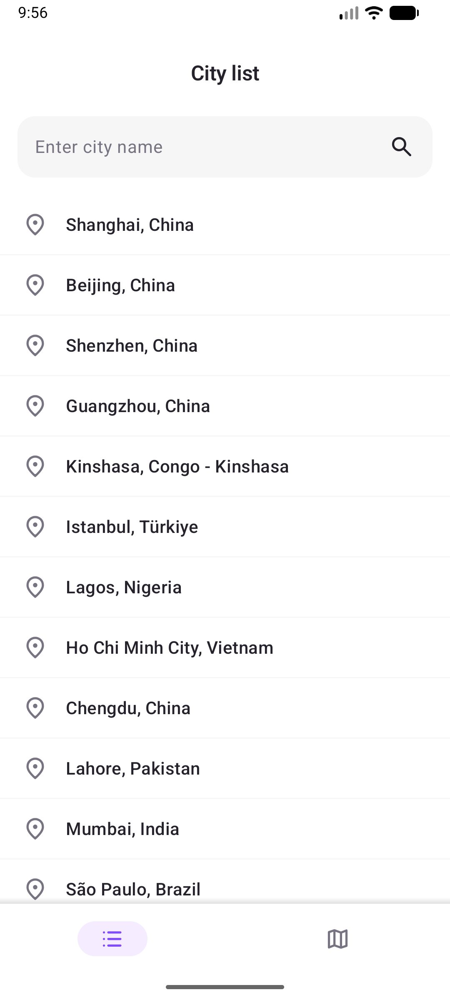
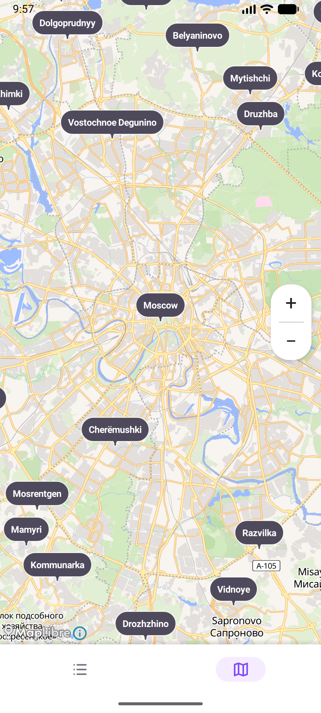
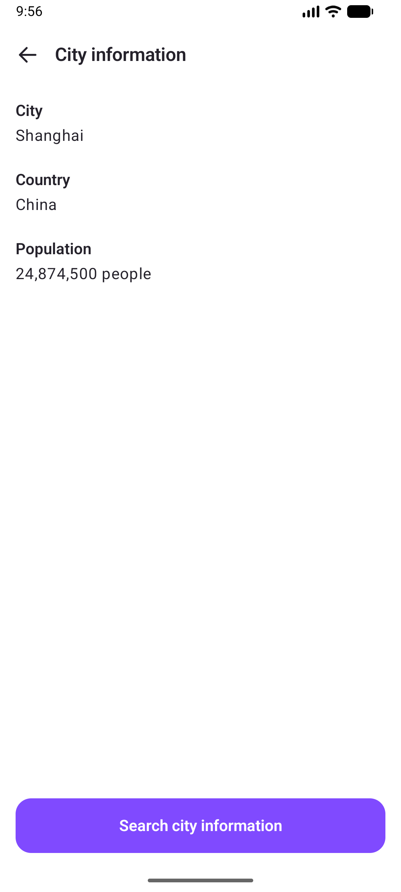
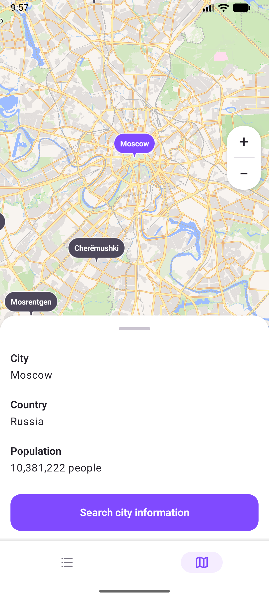
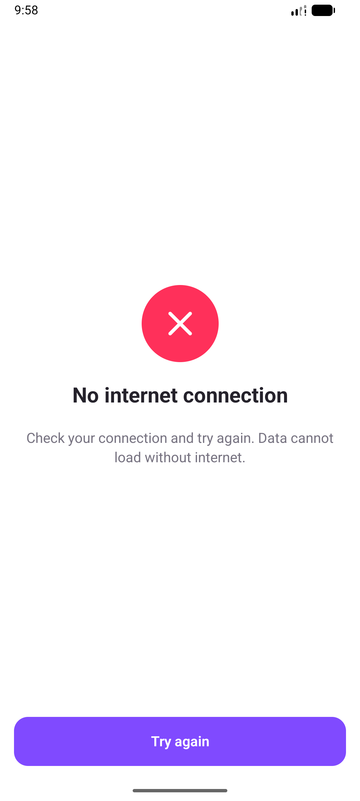

# URent test assessment

Android-приложение для поиска городов и просмотра их на карте.
[Исходное задание](docs/TASK.md) · [Спецификация проекта](docs/PROJECT_SPEC.md)

TODO: после публикации APK добавить ссылку на последний GitHub Release для скачивания приложения.

## Возможности

- Список городов с поиском и пагинацией.
- Переключение между списком и картой с сохранением состояния экранов.
- Отображение городов в выбранной области карты и управление масштабом.
- Информация о городе из списка и выбранного пина: название, страна, население.
- Поиск информации о городе в браузере с сообщением, если браузер недоступен.

## Скриншоты

Список городов и карта:

| Список городов | Карта с городами |
| --- | --- |
|  |  |

Информация о выбранном городе:

| Отдельный экран | Карточка на карте |
| --- | --- |
|  |  |

Ошибка при запуске без интернета:



## Что я бы доработал в реальном проекте

При большем запасе времени и развитии задания в полноценный продукт я бы в первую очередь доработал следующее:

- **Кэш городов и пинов.** Сейчас отдельного кэша нет: при изменении области карты города
  запрашиваются заново. Во время загрузки и при ошибке старые пины сохраняются; после успешного
  ответа они заменяются результатом запроса. Стоит добавить кэш для повторного просмотра
  областей карты, группировку городов и приоритизацию крупных и известных городов
  при отображении большой области.
- **Данные карточки города.** Сейчас данные передаются в route через навигацию, для трех полей это ок.
  По-хорошему нужно передавать только id города, остальные данные получать из кеша через репозиторий.
- **Карта с гарантиями доступности.** Вместо OpenFreeMap взял бы что-то более надежное и с 
  нормальным SLA. Эту карту выбрал за отсутствие API ключей чтобы облегчить ревью.
- **Очистка поиска.** Можно вместо лупы показывать крестик чтобы быстро очищать поисковый запрос
  на списке городов. Не стал реализовывать потому что в дизайне было явно указано что нужна лупа.

## Стек

Kotlin, Jetpack Compose, Orbit MVI, Koin, Ktor и AndroidX Navigation Compose.
Проект разделён на `app`, общие модули `core` и функциональные модули `feature`.
Общие настройки сборки и проверок вынесены в convention plugins в `build-logic`.
Логирование построено на Timber и включено только в debug-сборках.

## Сборка и проверки

Нужны JDK 25 и Android SDK; путь к SDK задаётся через `ANDROID_HOME` или `local.properties`.

```shell
./gradlew assembleDebug
./gradlew testDebugUnitTest lintDebug ktlintCheck detekt checkBuildLogic
```

[GitHub Actions](.github/workflows/ci.yml) выполняет проверки для PR и ветки `main`.
